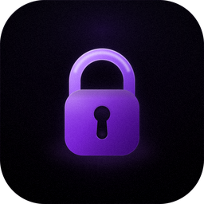

<div align="center">

  

  # Doopass

  **A cross-platform password manager for the terminal, the browser and phones — rewritten in .NET 10.**

  [](https://dotnet.microsoft.com/)
  [](#run-it)
  [%20%2B%20Android%20thin%20client-7c3aed)](#run-it)
  [](LICENSE)

</div>

Doopass keeps everything in a single encrypted `store.enc` file and offers
three front-ends for it:

* a **TUI** built on Terminal.Gui v2 that mirrors the original Textual interface;
* a **custom-styled web UI** (ASP.NET Core Blazor Server) with light and dark
  themes, served as a local web app;
* an **Android thin client** (MAUI + Blazor) that connects to the same host
  over a private REST API — the phone stores nothing but the host address,
  its certificate pin and the session token.

This project is a from-scratch .NET 10 rewrite of the original
[Doopass](https://github.com/doopath/PasswordManager/) (Python + Textual). The
encrypted store format is **fully compatible**, so existing files open without
any migration — just point the new app at the same `~/doopass` folder.

## Features

- **Drop-in compatible** with the original Python implementation: Fernet crypto
  (AES-128-CBC + HMAC-SHA256) derived with PBKDF2-HMAC-SHA256 (100 000 iterations).
- **Three front-ends, one store** — the same vault is available in the terminal,
  in the browser and on an Android phone, with dated backups, restore and
  settings everywhere.
- **Thin-client architecture** — the host is the single unlocked vault; every
  client (browser session or API token) shares the encrypted file safely.
- **Self-contained single-file executables** for Windows and Linux — no .NET
  runtime required, and all web assets are embedded in the binary.
- **Installable web app (PWA)** — opens as its own window on desktop and mobile,
  with a basic offline shell and its own icons.
- **Launch at sign-in** — helper scripts install a Windows startup shortcut or a
  `systemd` user service.
- **Plain, honest data** — everything lives in `~/doopass/appdata`, the log file
  never records secrets, and it rotates at 5 MB.

## Requirements

- [.NET SDK 10.0](https://dotnet.microsoft.com/) or newer

## Build and test

```bash
dotnet build Doopass.slnx
dotnet test Doopass.slnx                 # all test projects
```

## Run it

### Terminal UI

```bash
dotnet run --project src/Doopass.Cli
```

Hotkeys (press <kbd>F1</kbd> any time for the built-in help):

| Keys                                | Action                                                    |
| ----------------------------------- | --------------------------------------------------------- |
| <kbd>J</kbd>/<kbd>K</kbd> or <kbd>↑</kbd>/<kbd>↓</kbd> | move the selection, scroll the list       |
| <kbd>H</kbd>/<kbd>L</kbd>           | move focus left / right between regions                    |
| <kbd>Enter</kbd>                    | select, copy the secret, submit the form                   |
| <kbd>Tab</kbd>/<kbd>Shift+Tab</kbd> | move focus between the list, fields and buttons            |
| <kbd>PgUp</kbd>/<kbd>PgDn</kbd>     | scroll a list or a value by a page                         |
| <kbd>Home</kbd>/<kbd>End</kbd>      | jump to the first / last item                              |
| <kbd>V</kbd>                        | reveal or hide the selected value (store screen)           |
| <kbd>E</kbd> / <kbd>D</kbd> / <kbd>A</kbd> | edit, delete or add a pair (store screen)           |
| <kbd>C</kbd> / <kbd>R</kbd> / <kbd>D</kbd> | create, restore or delete a backup                  |
| <kbd>0</kbd>                        | restore default settings (settings screen)                 |
| <kbd>G</kbd>                        | lock the vault: forget the password, back to the menu      |
| <kbd>Esc</kbd>                      | go back one screen                                         |
| <kbd>Q</kbd>                        | quit Doopass                                               |

### Web UI

```bash
dotnet run --project src/Doopass.Cli -- serve            # http://localhost:7240
dotnet run --project src/Doopass.Cli -- serve --port 7240 --lan
```

`serve` options:

| Option                        | Description                                     |
| ----------------------------- | ----------------------------------------------- |
| `--port N` (`-p`)             | HTTP port (default `7240`)                      |
| `--no-browser`                | do not open the browser automatically           |
| `--lan` (`--network`)         | listen on `0.0.0.0` instead of `localhost`      |
| `--tls <pfx> [--tls-pass P]`  | serve HTTPS from a PKCS#12 certificate; the      |
|                               | startup log prints the SHA-256 fingerprint,      |
|                               | which thin clients pin for trust-on-first-use    |
| `--announce`                  | force LAN discovery announce (also on with `--lan`) |

The UI and all assets are embedded in the executable, so nothing else is needed
to serve the app. Open <http://localhost:7240> and log in or initialize a store.

### REST API and thin clients

`serve` mode also exposes a private REST API for thin clients (the Doopass
Android app) and a SignalR channel for change push, both on the same port:

* `GET /api/vault/state` — anonymous: `{storeExists, unlocked, serverVersion, certFingerprint}`.
* Everything else is `Authorization: Bearer <token>`; tokens come from
  `POST /api/auth/login` / `POST /api/auth/init` and die on logout or a sliding
  30 min TTL (configurable via the optional `api.session_ttl_minutes` key in
  `settings.json`).
* Vault pairs, backups and settings live under `/api/vault/*`, `/api/backups*`
  and `/api/settings*` — full table in `THIN_CLIENT_PROMPT.md`.
* Changes made by any client raise `vaultChanged` / `backupsChanged` /
  `settingsChanged` on the `/hubs/vault` SignalR channel, so every connected
  device updates without reloads.
* `secret` responses carry `Cache-Control: no-store`; errors are always
  `{ "error": "<message>" }` with 400/401/404/409 semantics; login/init are
  rate-limited to 5 requests per minute per IP (429 after that).

### LAN discovery

With `--lan` (or `--announce`), the host answers UDP broadcasts on port 7241:
send the ASCII datagram `DOOPASS_DISCOVER`, get back the JSON announcement with
the host name, web port, TLS flag and certificate fingerprint. Phones use this
to find the PC without typing an address — allow **inbound UDP 7241** in your
firewall (the autostart installers do it on Windows / ufw).

When the API is exposed, the host also relays and keeps its vault consistent:
after a backup restore the coordinator re-reads the store automatically, and
`vaultLocked` is pushed to clients whose session ended (logout elsewhere, TTL,
`G`-lock in the TUI happens on TTL as well).

#### Install as an app (PWA)

The web interface is an installable Progressive Web App — installed apps run in
their own window, like a desktop application:

* **Chrome / Edge** — Settings → *Install as app*, or the install icon in the
  address bar.
* **iOS (Safari 16.4+)** — Share → *Add to Home Screen*.
* **Android** — Chrome or Samsung Internet: *Install app* / *Add to Home screen*
  (creates a real WebAPK with the Doopass icon).
* **Safari 17 (macOS)** — File menu → *Add to Dock*.
* **Firefox desktop** does not support installing web apps; mobile Firefox adds
  only a home-screen shortcut.

The app ships its own manifest, service worker and icons, all embedded in the
executable and served from virtual routes (`/pwa/manifest.webmanifest`,
`/pwa/sw.js`, …) — a single-file build supports installation with no extra
files. The service worker offers a basic offline shell; vault operations still
need the server and reconnect over their existing SignalR circuit.

> [!IMPORTANT]
> Installation requires a **secure origin**: `http://localhost` or any HTTPS
> host. A plain-HTTP LAN address (`--lan` without TLS) can use the UI but
> cannot install the app.

To regenerate the icons after a design change, drop the new artwork into
`assets/` and run:

```bash
python scripts/generate-icons.py    # PWA icons + favicons + Android icon + exe icon + brand mark
```

It resizes the PNG master into every size the app needs (writing the generated
files to `.pwa-assets/`, which the csprojs embed), refreshes
`src/Doopass.Mobile/Resources/AppIcon/appicon.png`, and copies the vector master
`assets/logo.svg` into the RCL as the sidebar / login brand mark
(`src/Doopass.WebUi/wwwroot/brand.svg`, served as the SVG favicon too).

#### PWA vs the Android thin client

The PWA runs the **web** UI in a browser window — it needs the Blazor Server
connection. The Android app is a **native** thin client with its own icon and
its own discovery flow; installing one does not conflict with the other. If you
manage secrets mainly from a phone, the Android app is the stronger choice: it
survives browser sessions, pins the host certificate and warns clearly before
using an unencrypted connection.

## Android thin client

The phone holds **no vault** — it stores only the host address, the pinned
certificate fingerprint and the session token (in SecureStorage / Android
Keystore). Everything else lives on the PC host.

### Build and install

Requirements: .NET SDK 10 with the `maui-android` workload, an Android SDK
(`platforms;android-36`, `build-tools;36.0.0`) and a JDK 17+ (JDK 21 is what
the .NET 10 Android pack expects), with `ANDROID_HOME` (or `ANDROID_SDK_ROOT`)
and `JAVA_HOME` pointing at them.

```powershell
scripts\build-android.ps1                       # Windows: Debug APK (installable directly)
```

```bash
scripts/build-android.sh                        # Linux/macOS: Debug APK (installable directly)
```

```bash
dotnet publish src/Doopass.Mobile -c Release -f net10.0-android -p:AndroidPackageFormat=apk
dotnet publish src/Doopass.Mobile -c Release -f net10.0-android -p:AndroidPackageFormat=aab   # Play-format bundle
```

Artifacts:

* `src/Doopass.Mobile/bin/Debug/net10.0-android/io.github.doopath.doopass-Signed.apk`
* `src/Doopass.Mobile/bin/Release/net10.0-android/io.github.doopath.doopass-Signed.apk`

> [!NOTE]
> The first release builds run with AOT/trimming disabled (full IL) for stable
> diagnostics; enabling them needs a `TrimmerRootDescriptor.xml` pass for the
> System.Text.Json and SignalR reflection surfaces. Debug APKs embed their
> assemblies too (Fast Deployment is off), so they are directly installable
> with `adb install` — no IDE staging required.

### Connecting

1. Start the host on the PC: `doopass serve --lan` (plain HTTP + discovery).
   Prefer `--tls mycert.pfx --tls-pass …` — the app then pins the SHA-256
   fingerprint printed in the host log and warns loudly when it is absent.
2. On the phone: the **Connect** screen scans the LAN over UDP as soon as it
   opens — pick a discovered host, or switch to *Manual* and type the address
   (e.g. `http://192.168.1.10:7240`). *Search again* re-runs the scan.
3. Confirm the fingerprint ("Trust and connect"), then log in with the master
   password. Everything afterwards mirrors the web version, pushed live:
   pairs, copy, backups (incl. safety backups on restore), settings, themes.

The login card always shows the current host with a **Change host** action
that returns to the picker, whether or not that host still answers — so a
moved host does not require reinstalling or clearing app data. If the saved
address stops answering (for example the PC got a new IP), the app says so
above the password field after a short probe and leaves the session token in
place; pick the host again, or go back to the login screen without changing
anything.

Features and limitations:

* the app reads `vaultChanged` / `backupsChanged` / `settingsChanged` /
  `vaultLocked` events from the `/hubs/vault` SignalR channel and stays in
  sync with the web UI and other phones;
* a 30 min sliding session TTL relocks the vault; expired tokens land on the
  login screen automatically;
* a stale host address is detected in about four seconds instead of waiting
  for a long request timeout, and the login screen offers the host picker;
* discovery probes both `255.255.255.255` and each interface's directed
  broadcast (e.g. `192.168.31.255`), which survives Wi-Fi stacks that drop the
  global broadcast;
* the emulator cannot reach LAN broadcasts — type `http://10.0.2.2:7240`
  manually there;
* plain HTTP shows a permanent warning; IPSec rules of the router or at least
  `--tls` are recommended on shared networks.

#### Discovery finds nothing?

The phone and the PC must be on the same Wi-Fi/LAN, and the PC firewall must
allow both the discovery probe and the API port. With `ufw` (the default on
Omarchy/Arch desktops):

```bash
sudo ufw allow 7241/udp comment 'Doopass discovery'
sudo ufw allow 7240/tcp comment 'Doopass web/API'
# if the host was started with --port 7241, allow that TCP port instead:
sudo ufw allow 7241/tcp comment 'Doopass web/API (custom port)'
```

USB debugging alone does not carry UDP broadcasts. For a cable-only setup,
forward the API port to the phone's loopback and type that address into
*Manual*:

```bash
adb reverse tcp:7240 tcp:7240
# in the app's Manual tab: 127.0.0.1:7240
```

Make sure only one host process is running on the PC: a stale `doopass serve`
on the saved port can answer the app's probe with an old build that has no
REST API, which looks exactly like "the host is unreachable". Check the
listening sockets with `ss -ltnp | grep doopass`.

> [!NOTE]
> On some Xiaomi/Redmi HyperOS builds, `adb install` needs *Developer options →
> Install via USB* (and sometimes *USB debugging (Security settings)*) to be
> enabled; without it the installer reports
> `INSTALL_FAILED_USER_RESTRICTED: Install canceled by user`.

## Deploy it

### Portable single-file build

```powershell
scripts\publish-portable            # or: powershell -File scripts\publish-portable.ps1
```

```bash
scripts/publish-portable.sh                    # both platforms
scripts/publish-portable.sh -r linux-x64       # a single target
scripts/publish-portable.sh -c Debug -o /tmp/doopass
```

The two scripts are equivalent and can cross-publish from either OS: the
PowerShell one takes `-Configuration`, `-RuntimeIdentifiers` and `-OutputRoot`,
the shell one takes `-c`, `-r` (comma-separated or repeated) and `-o`. Defaults
are `Release`, `win-x64` + `linux-x64` and `dist/portable`; the shell script also
marks the Linux binary executable.

Produces one self-contained executable per platform (no .NET install needed):

* `dist/portable/win-x64/doopass.exe`
* `dist/portable/linux-x64/doopass`

Only the executable ends up in the output folder: `.pdb` symbol files are
removed after publishing, including stale ones that an incremental build may
have copied from `bin/`. Ship the binary as is — symbols are debugger-only and
are not needed at runtime.

> [!NOTE]
> Distro SDK packages ship ASP.NET Core as a separate package. If publishing
> fails with `NETSDK1226: Prune Package data not found … Microsoft.AspNetCore.App`,
> install the matching ASP.NET Core pack — `aspnet-runtime` + `aspnet-targeting-pack`
> on Arch/Omarchy, `aspnetcore-runtime-10.0` + `aspnetcore-targeting-pack-10.0`
> on Debian/Ubuntu, the same names via `dnf` on Fedora. The script prints this
> hint on its own when it detects that error.

Run it directly:

```bash
dist\portable\win-x64\doopass.exe serve --port 7240     # Windows
chmod +x dist/portable/linux-x64/doopass                # Linux
./dist/portable/linux-x64/doopass serve                 # Linux
```

### Release archives

```powershell
scripts\package-release             # after publish-portable
```

Builds archives ready for GitHub Releases:

* `dist/release/doopass-5.0.0-win-x64.zip` (exe + install/uninstall scripts + README)
* `dist/release/doopass-5.0.0-linux-x64.tar.gz` (exe + install/uninstall scripts + systemd unit + README)

### Autostart at sign-in

The installers take the executable path as the first argument and copy it to
`~/.local/bin` (`%USERPROFILE%\.local\bin` on Windows).

**Windows**

```powershell
powershell -File scripts\install-autostart-win.ps1 .\doopass.exe            # localhost
powershell -File scripts\install-autostart-win.ps1 .\doopass.exe lan        # LAN
powershell -File scripts\uninstall-autostart-win.ps1
```

Options: `-Port 7240`, `-DryRun`, `-NoDesktopShortcut`.

**Linux**

```bash
scripts\install-autostart-linux.sh ./doopass                 # localhost
scripts\install-autostart-linux.sh ./doopass lan [--linger]  # LAN
scripts\uninstall-autostart-linux.sh
```

Installs a `systemd` **user service** (`~/.config/systemd/user/doopass.service`)
started with `enable --now`.

> [!WARNING]
> `lan` mode listens on all network interfaces over plain HTTP and is only
> appropriate on a trusted network.

## Where your data lives

By default everything uses `~/doopass/appdata` — the same location as the
original Python implementation — so an existing `store.enc` and
`settings.json` are picked up automatically. Override the root with the
`DOOPASS_HOME` environment variable.

```
~/doopass/
└── appdata/
    ├── store.enc        # encrypted store
    ├── settings.json    # application settings
    ├── backups/         # dated store backups
    └── doopass.log      # log file
```

Application events (start/stop, store and backup operations, settings changes,
errors) are appended to `doopass.log`, which rotates at 5 MB.

> [!NOTE]
> Secrets are never written to the log.

## The store file

The on-disk format is byte-for-byte compatible with the original Doopass:

```
base64url( salt[16] || iterations[4, big-endian] || fernet_token )
```

where `fernet_token = 0x80 || timestamp[8] || IV[16] || AES-128-CBC(ciphertext) || HMAC-SHA256(32)`.
The plaintext is a newline-separated list of `key = value` pairs, encrypted
with a key derived from your master password (PBKDF2-HMAC-SHA256, 100 000
iterations by default). The master password is kept in memory only and erased
on lock (<kbd>G</kbd>), exit or server shutdown.

## Project layout

| Project                      | Description                                                     |
| ---------------------------- | --------------------------------------------------------------- |
| `src/Doopass.Core`           | Store, Fernet/PBKDF2 crypto, settings, backups, validation, logs |
| `src/Doopass.Tui`            | Terminal.Gui v2 interface (mirrors the original TUI)             |
| `src/Doopass.WebUi`          | Shared Razor Class Library: components, themes, IVaultSession    |
| `src/Doopass.Cli`            | Single entry point: TUI or web host (Blazor + REST API + hub)    |
| `src/Doopass.Mobile`         | Android thin client (MAUI + Blazor WebView)                      |
| `tests/Doopass.Core.Tests`   | xUnit tests: format compatibility, CRUD, backups, settings       |
| `tests/Doopass.Tui.Tests`    | xUnit tests: key mapping and screen behaviour                    |
| `tests/Doopass.Api.Tests`    | xUnit integration tests: the REST API on a real host             |

---

Doopass is a rewrite of the original [Doopass](https://github.com/doopath/PasswordManager/)
and follows the same license (GPL-3.0 — see the [LICENSE](LICENSE) file).
